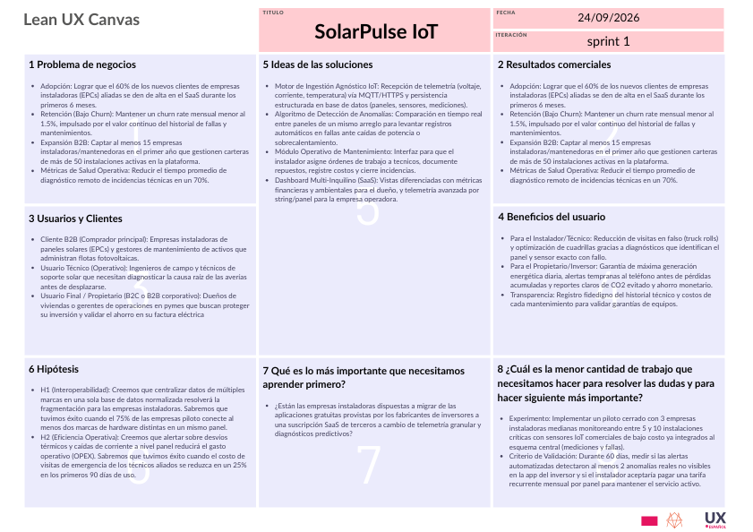
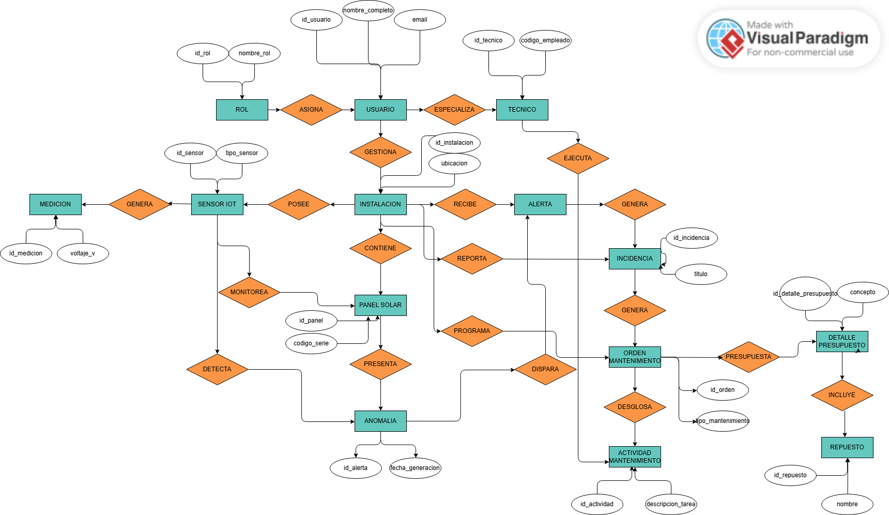
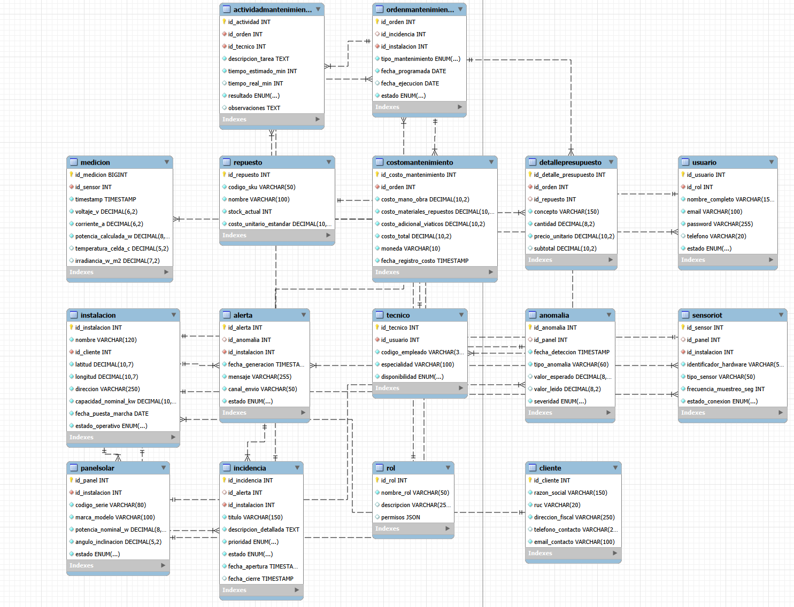
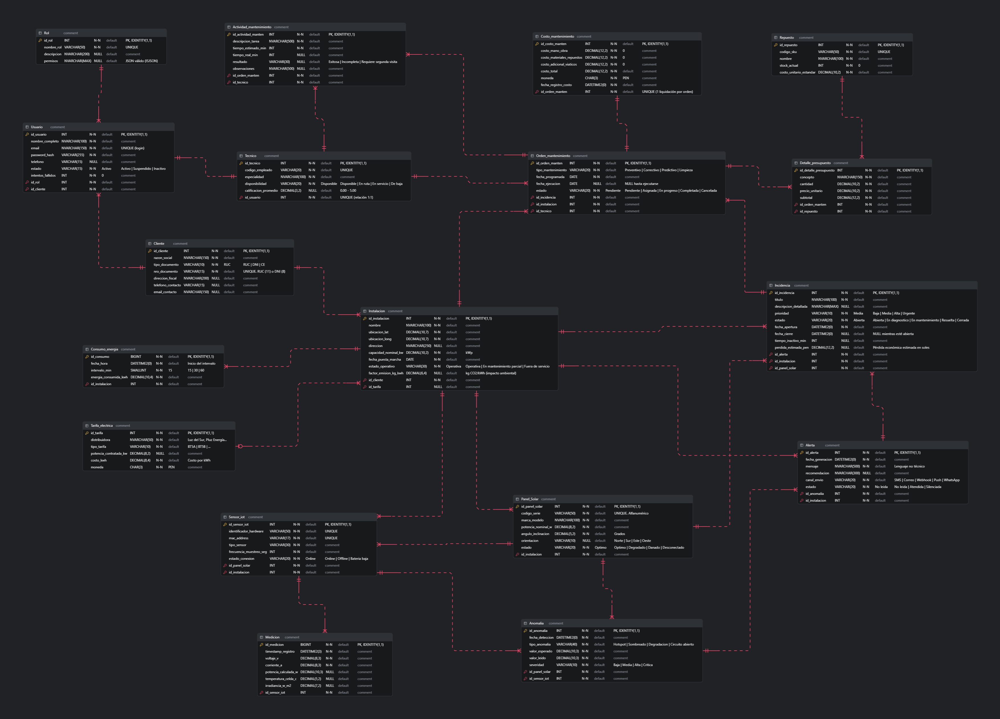
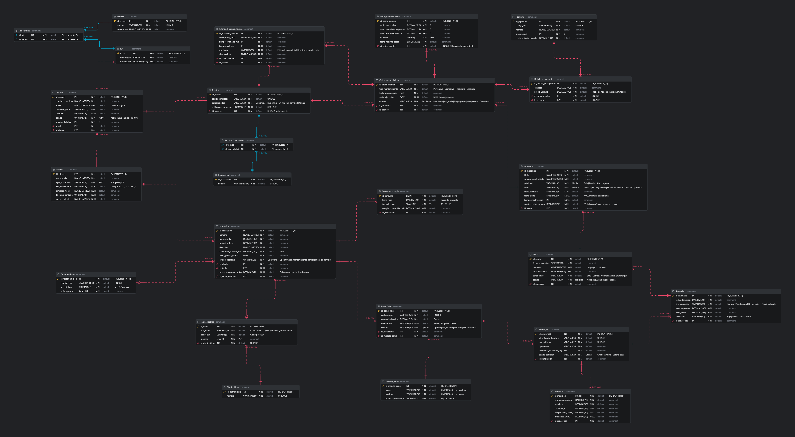
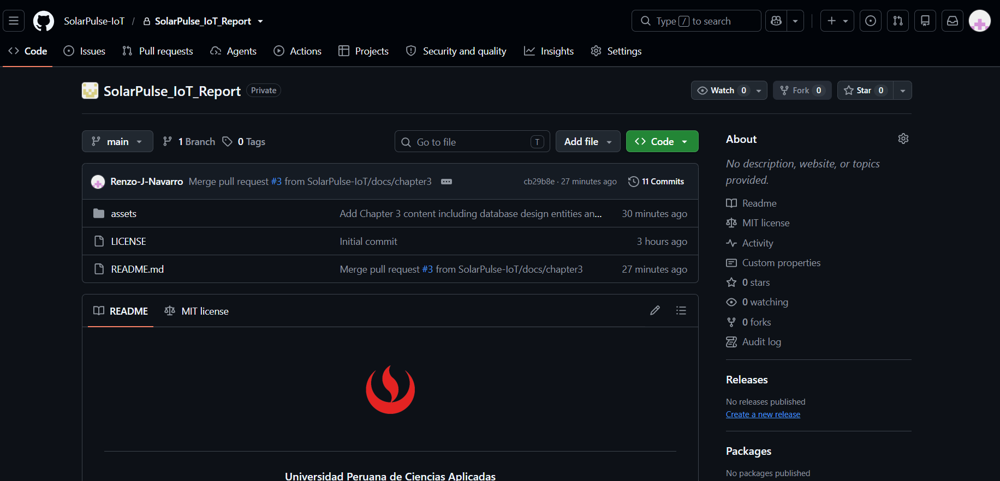
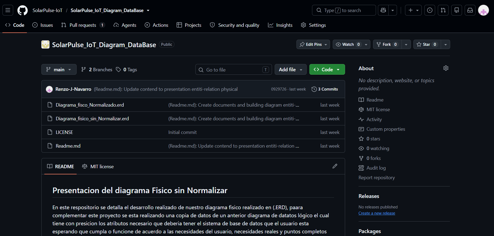

  

---

<strong><big>Universidad Peruana de Ciencias Aplicadas</big></strong>

<strong>Ingeniería de Software</strong>

<strong>Ingenieria de Sistemas de Información</strong>

<strong><big>Periodo: </big></strong>2026-20

<strong><big>Curso: </big></strong>1ASI0787 | Base de datos

<strong><big>NRC: </big></strong>15869

<strong><big>Docente: </big></strong> Rafael Oswaldo Castro Veramendi

---

<strong><big>Informe del Trabajo Final</big></strong>

<strong><big>Nombre del startup</big></strong> Heliosync Technologie

<strong><big>Nombre del producto</big></strong> SolarPulse IoT

<strong><big>Relacion integrantes</big></strong>

| Código     | Apellidos y Nombres                   |
|------------|---------------------------------------|
| U20211A574 | Navarro Flores Renzo Jesus            |
| U20221f624 | Bravo Castillo Rojo Miguel Alejandro  |
| U20241B647 | Quispe Vargas Juan Carlos             |
| U202410464 | Martínez Zeta José Alonso             |
| U20221A006 | Soto Vásquez, María Fernanda          |

# Registro de versiones

<table>
    <thead>
        <tr>
            <th>Versión</th>
            <th>Fecha</th>
            <th>Autores</th>
            <th>Descripción de modificaciones</th>
        </tr>
        <tbody>
            <tr>
                  <td rowspan="5" style="text-align: center; vertical-align: middle;"><b>TP1</b></td>
                  <td style="vertical-align: middle;">14/09/2026</td>
                  <td>
                    <ul style="margin: 0; padding-left: 30px;">
                    <li>Renzo Jesus, Navarro Flores</li>
                    <li>Miguel Alejandro, Bravo Catillo Rojo</li>
                    <li>Juan Carlo, Quispe Vargas</li>
                    <li>José Alonso, Martínez Zeta</li>
                    <li>María Fernanda, Soto Vásquez</li>
                    </ul>
                  </td>
                  <td>Se realizaron las correcciones pertinentes de nuestros diagramas para realizar las exportaciones a los sistema de gestión de bases de datos relacional (SQL) y no relacional (NoSQL). Posteriormente se haces las consultas y los diagramas en el sistema de MSSQL y Mongodb para poder evaluar los pro y contras que tiene cada sistema al momento de manejar nuestros datos.</td>
            </tr>
        </tbody>
        <tbody>
            <tr>
                  <td rowspan="5" style="text-align: center; vertical-align: middle;"><b>TF1</b></td>
                  <td style="vertical-align: middle;">14/09/2026</td>
                  <td>
                    <ul style="margin: 0; padding-left: 30px;">
                    <li>Renzo Jesus, Navarro Flores</li>
                    <li>Miguel Alejandro, Bravo Catillo Rojo</li>
                    <li>Juan Carlo, Quispe Vargas</li>
                    <li>José Alonso, Martínez Zeta</li>
                    <li>María Fernanda, Soto Vásquez</li>
                    </ul>
                  </td>
                  <td>Desarrollo de nuestro diseño complementario de la base de datos de SolarPulse IoT en base a las entrevistas obtenidas, se plantea el diseño del diagrama de entidad-relación lógico, diagrama de entidad-relación físico y se determina que software de base de datos vamos a usar.</td>
            </tr>
        </tbody>
    </thead>
</table>

# Project Report Collaboration Insights

**URL del repositorio del informe:** https://github.com/SolarPulse-IoT/SolarPulse_IoT_Report

### TP1

**Descripción de la colaboración en la elaboración del informe:**

Para el Trabajo Parcial, el equipo de SolarPulse IoT organizó la elaboración del informe mediante la asignación de tareas a cada integrante, distribuidas por capítulos y apartados. Se coordinaron los avances, se identificaron contenidos pendientes y se acordaron ajustes en las entrevistas, Requisitos funcional y no funcionales, diseños dos diagramas de bases de datos en .erd y diseñar del modelado fisico llevado SQL Server. Asimismo, se asignó la preparación de la carátula, el índice y la estructura del Student Outcome en el documento Markdown. Esta distribución de responsabilidades facilitó el seguimiento de las tareas y la integración de los aportes del equipo para la entrega.

# Tabla de Contenido

- [Registro de versiones](#registro-de-versiones)
- [Tabla de contenidos](#tabla-de-contenido)
- [Student outcome](#student-outcome)
- [CAPÍTULO I: INTRODUCCIÓN](#capítulo-i-introducción)
  - [1.1. Startup profile](#11-startup-profile)
    - [1.1.1. Descripción de startup](#111-descripción-de-startup)
    - [1.1.2. Perfiles de integrantes del grupo](#112-perfiles-de-integrantes-del-grupo)
  - [1.2. Solution Profile](#12-solution-profile)
    - [1.2.1. Antecedentes y problemáticas](#121-antecedentes-y-problemáticas)
    - [1.2.2. Propuestas de valor](#122-propuestas-de-valor)
  - [1.3. Segmentos objetivo](#13-segmentos-objetivo)
- [CAPÍTULO II: RECOPILACIÓN Y ANÁLISIS DE REQUISITOS](#)
  - [2.1. Entrevistas](#21-entrevistas)
    - [2.1.1 Diseño de entrevistas](#211-diseño-de-entrevistas)
    - [2.1.2. Registro de entrevistas](#212-registro-de-entrevistas)
    - [2.1.3. Análisis de entrevistas](#213-análisis-de-entrevistas)
  - [2.2. Requisitos](#22-requisitos)
    - [2.2.1. Requisitos funcionales](#requisitos-funcionales)
    - [2.2.2. Requisitos No funcionales](#requisitos-no-funcionales)
- [CAPÍTULO III: DISEÑO DE BASE DE DATOS](#capítulo-iii-diseño-de-base-de-datos)
  - [3.1. Entidades](#31-entidades)
  - [3.2. Atributos](#32-atributos)
  - [3.3. Enfoque relacional](#33-enfoque-relacional)
    - [3.3.1 Diagrama entidad-relación lógico](#331-diagrama-entidad-relación-lógico)
  - [3.4. Enfoque no realacional](#34-enfoque-relacional)
    - [3.4.1. Colecciones]()
    - [3.4.2. Validación de esquema]()
    - [3.4.3. Patrones de modelo de datos]()
- [CAPÍTULO IV: IMPLEMENTACIÓN DE BASE DE DATOS](#capítulo-iv-implementación-de-base-de-datos)
  - [4.1. Sistemas de gestión de base de datos](#41-sistemas-de-gestión-de-base-de-datos)
    - [4.1.1. Evaluación y elección del sistema de gestión de base de datos relacional](#411-evaluación-y-elección-del-sistema-de-gestión-de-base-de-datos-relacional)
    - [4.1.2. Evaluación y elección del sistema de gestión de base de datos no relacional]()
  - [4.2. Diagramas de datos](#42-diagramas-de-datos)
    - [4.2.1. Diagrama entidad-relación físico](#421-diagrama-entidad-relación-físico)
    - [4.2.2. Diagrama de documentos]()
  - [4.3. Scripts de creación de la base de datos]()
    - [4.3.1. Scripts de creación y carga de datos de la base de datos relacional]()
    - [4.3.2. Scripts de creación y carga de datos de la base de datos no relacional]()
  - [4.4. Consultas]()
    - [4.4.1. Consultas para la base de datos relacional]()
    - [4.4.2. Consultas para la base de datos no relacional]()
- [Conclusiones](#conclusiones)
- [BIBLIOGRAFÍA](#bibliografía)
- [ANEXOS](#anexos)

    

# Student outcome

El curso contribuye al cumplimiento del Student Outcome ABET:

**ABET – EAC - Student Outcome 4**

**Criterio:** La capacidad de reconocer responsabilidades éticas y profesionales en situaciones de ingeniería y hacer juicios informados, que deben considerar el impacto de las soluciones de ingeniería en contextos globales, económicos, ambientales y sociales.

En el siguiente cuadro se describe las acciones realizadas y enunciados de conclusiones por parte del grupo, que permiten sustentar el haber alcanzado el logro del ABET – EAC - Student Outcome 4.

| Criterio específico | Acciones realizadas | Conclusiones |
| --- | --- | --- |
| 7.c1. Actualiza conceptos y conocimientos necesarios para su desarrollo profesional y en especial para su proyecto en soluciones de ingeniería de software. | **Navarro Flores, Renzo Jesus** **TP1:** Lideró la estructuración integral de la documentación del proyecto, garantizando el cumplimiento de los estándares académicos y normativos de tipografía, gramática y formato. Asimismo, desarrolló el Capítulo IV relativo a la implementación del sistema gestor de bases de datos, así como la consolidación de las conclusiones, referencias bibliográficas bajo norma APA y la gestión de anexos técnicos.  **Miguel Alejandro, Bravo Catillo Rojo** **TP1:** Diseñó el Capítulo III correspondiente a la arquitectura de datos, definiendo el catálogo formal de entidades y atributos. Modeló el enfoque relacional del sistema y diseñó el Diagrama Entidad-Relación conceptual basándose en el análisis y extracción sistemática de requerimientos derivados de las entrevistas de campo.  **Juan Carlo, Quispe Vargas** **TP1:** Desarrolló la sección Startup Profile, formulando la visión, misión y propuesta de valor de la organización. Adicionalmente, estructuró los perfiles profesionales de los integrantes del equipo de ingeniería y elaboró la matriz de trazabilidad del Student Outcome.  **José Alonso, Martínez Zeta** **TP1:** Elaboró la sección Solution Profile, analizando los antecedentes y la problemática del sector mediante el marco W6H. Diseñó las hipótesis de negocio a través del Lean UX Canvas y especificó la matriz de Requisitos No Funcionales garantizando atributos de calidad en escalabilidad, disponibilidad y tiempo de respuesta.  **María Fernanda, Soto Vásquez** **TP1:** Estructuró el marco de recopilación de requisitos, consolidando el registro formal y el análisis cualitativo de las entrevistas aplicadas. A partir de ello, definió y categorizó la especificación formal de Requisitos Funcionales (Historias de Usuario) vinculados a sus entidades dominio.  **Adriel Jose, Flores Masias** **TP1:** Diseñó e implementó la estrategia de campo para el levantamiento de información en los segmentos objetivo. Planificó la batería de preguntas de las entrevistas y coordinó la producción audiovisual y empaquetado del material de exposición validado para el informe final. | **TP1:** El equipo demostró una sólida integración de los fundamentos de la ingeniería de software al abordar de manera integral el análisis, modelado y diseño de la solución para SolarPulse IoT durante la entrega TP1. Asimismo, la rigurosa validación de requisitos, el cumplimiento de las normativas del informe y la correcta estructuración conceptual, lógica y relacional de la arquitectura de datos garantizan una base técnica de alto nivel académico y alineada con las mejores prácticas del sector. |
| 7.c2. Reconoce la necesidad del aprendizaje permanente para el desempeño profesional y el desarrollo de proyectos en soluciones de tecnologías de ingeniería de software. | **Navarro Flores, Renzo Jesus** **TP1:** Comprendí la importancia de la mejora continua al estructurar integralmente el proyecto, asegurando la calidad y el rigor técnico en la documentación y en la validación del capítulo final.  **Miguel Alejandro, Bravo Catillo Rojo** **TP1:** Asumí el reto de investigar y profundizar en el diseño conceptual y relacional de bases de datos, reconociendo la necesidad de actualizar mis competencias para modelar requerimientos complejos.  **Juan Carlo, Quispe Vargas** **TP1:** Valoré la necesidad del aprendizaje autónomo al investigar a fondo la definición de perfiles de startup y modelos de negocio tecnológicos aplicados a la ingeniería.  **José Alonso, Martínez Zeta** **TP1:** Identifiqué la importancia de mantenerme actualizado en metodologías de diseño y análisis de requerimientos no funcionales para asegurar la viabilidad de la solución.  **María Fernanda, Soto Vásquez** **TP1:** Desarrollé habilidades de análisis crítico al estructurar el levantamiento y procesamiento de entrevistas, reconociendo el valor del aprendizaje continuo en la ingeniería de requisitos.   **Adriel Jose, Flores Masias** **TP1:** Comprendí la necesidad de adaptabilidad y búsqueda constante de información técnica para validar perfiles de usuario y diseñar presentaciones efectivas. | **TP1:** A través del trabajo colaborativo en el TP1, los integrantes reconocieron y ejercitaron el aprendizaje autónomo al investigar y profundizar en metodologías Lean UX, perfiles de negocio y modelado relacional de datos aplicados a la solución. |

# CAPÍTULO I: INTRODUCCIÓN

## 1.1. Startup profile

En esta sección, se presenta una descripción detallada de la startup, incluyendo su misión, visión y valores fundamentales así como una descripción de los integrantes que la conforman.

### 1.1.1. Descripción de startup

Somos “Heliosync Technologie” una Startup de base tecnológica especializada en telemetría IoT y arquitecturas de datos en la nube para optimizar activos fotovoltaicos distribuidos en tiempo real.
|Misión|Visión|
|------|------|
|Maximizar la eficiencia operativa y el retorno de inversión de instalaciones solares residenciales, comerciales e industriales mediante la centralización de datos IoT, analítica predictiva y gestión automatizada del mantenimiento.|Consolidarse como el ecosistema estándar de observabilidad e inteligencia operativa para microrredes y sistemas solares distribuidos en América Latina, acelerando la transición hacia matrices energéticas descarbonizadas y confiables.|

### 1.1.2. Perfiles de integrantes del grupo

<table>
  <tr>
    <th colsan="2">Navarro Flores, Renzo Jesus</th>
  </tr>
  <tr>
    <td>
      
    </td>
    <td>
      <b>Codigo:</b> u20211a574 
      <b>Carrera:</b> Ingenieria de Software 
      Soy estudiante de Ingeniería de Software en la Universidad Peruana de Ciencias Aplicadas. Cuento con conocimientos de desarrollo de documentación, requisitos y requerimientos, arquitectura de software y manejo de redes con cisco packet tracer y arduino. Dentro de SolarPulse IoT, aportaré mi lógica de análisis para buscar vulnerabilidades en el sistema y preparar contramedidas, responsabilidad y trabajo colaborativo.
    </td>
  </tr>

  <tr>
    <th colsan="2">Bravo Castillo Rojo, Miguel Alejandro</th>
  </tr>

  <tr>
    <td>
      
    </td>
    <td>
      <b>Codigo:</b> u20221f624 
      <b>Carrera:</b> Ingenieria de Software 
      Estudiante de la carrera de ingeniería de Software siento que puedo aportar al equipo con mis conocimientos acerca ux/ui y conocimientos en el lenguaje de programación C++ además siendo autocrítico con nuestra iniciativa para asi poder alcanzar un alto grado de satisfacción en el proyecto.
  </tr>

  <tr>
    <th colsan="2">Martínez Zeta, José Alonso</th>
  </tr>

  <tr>
    <td>
      
    </td>
    <td>
      <b>Codigo:</b> U202410464 
      <b>Carrera:</b> Ingenieria de Software 
      Poseo conocimientos en los lenguajes de programación C++, Python, y JS. Tambien tengo una capacidad analita buena, creatividad y adaptabilidad, los cuales me ayudaran al desarrollo de mi carrera y experiencia.
  </tr>

  <tr>
    <th colsan="2">Soto Vásquez, María Fernanda</th>
  </tr>

  <tr>
    <td>
      
    </td>
    <td>
      <b>Codigo:</b> U20221a006 
      <b>Carrera:</b> Ingenieria de Software 
      Me considero una estudiante comprometida y responsable, con muchas ganas de seguir aprendiendo y creciendo tanto a nivel académico como personal. Me gusta trabajar en equipo, aportar ideas y apoyar a mis compañeros para lograr objetivos en conjunto.
  </tr>

  <tr>
    <th colsan="2">Quispe Vargas, Juan Carlos</th>
  </tr>

  <tr>
    <td>
      
    </td>
    <td>
      <b>Codigo:</b> U20241N647 
      <b>Carrera:</b> Ingenieria de Software 
      Conocimientos en C++, Python, estructuras de datos, algoritmos, bases de datos, redes, arquitectura de computadores y desarrollo de software. Capacidad para resolver problemas, analizar requerimientos y desarrollar proyectos académicos aplicando fundamentos de ingeniería de software.
  </tr>

   <tr>
    <th colsan="2">Flores Masias, Adriel Jose</th>
  </tr>

  <tr>
    <td>
      
    </td>
    <td>
      <b>Codigo:</b> U202313231 
      <b>Carrera:</b> Ingenieria de Software 
      Cuento con conocimientos en lenguaje C++,  python, sql. Además cuento con la habilidad de ser comprometido con lo que hago y de poder anteponerme ante cualquier situación difícil de manejar tanto académico como situacional.
  </tr>

</table>

## 1.2. Solution Profile

En esta sección se describe el perfil de la solución propuesta, incluyendo los antecedentes y la problemática que aborda. Además, se usó la técnica de las 5W y 2H para comprender mejor el contexto y las necesidades del usuario. Finalmente, se desarrolló el proceso Lean UX para definir las posibles características y funcionalidades de la solución.

### 1.2.1. Antecedentes y problemáticas

#### A. Quiénes están involucrados (who)

Afecta principalmente a empresas instaladoras de paneles solares, técnicos de mantenimiento de campo y propietarios de activos fotovoltaicos (ya sean pymes comerciales o familias residenciales).

#### B. Qué problema resuelve la solución (What)

Existe una carencia de visibilidad operativa granular en los sistemas fotovoltaicos, lo que impide detectar a tiempo caídas de eficiencia y fallas tempranas en paneles específicos.

#### C. Cuándo ocurre el problema (When)

Ocurre de manera continua durante la operación diaria de los paneles solares, específicamente en el periodo entre que ocurre una falla silenciosa (como acumulación de suciedad o degradación térmica) y el momento en que se detecta en la facturación o revisión.

#### D. Dónde ocurre el problema (where)

En instalaciones de sistemas solares distribuidos en América Laina, con un enfoque inicial en Lima Metropolitana, donde factores climáticos como alta humedad, polvo y hollín urbano afectan los paneles.

#### E. Por qué es relevante este problema (Why)

Porque las soluciones actuales provistas por los fabricantes de inversores son cerradas, no interoperables y solo detectan anomalías a nivel macro. Esto oculta fallas individuales a nivel de panel y evita un diagnóstico preciso.

#### F. Cómo se gestiona actualmente el problema (How)

El problema se manifiesta mediante pérdidas energéticas que pasan desapercibidas y obligan a los instaladores a realizar visitas técnicas “a ciegas” para diagnosticar problemas en toda la red, saturando a las cuadrillas de mantenimiento.

#### G. Cuánto impacta el problema (How much)

- **Inversión:** Comprende los costos de sensores físicos, conectividad (celular o satelital) y consumo de computación en la nube para consolidar un centro de datos unificado en tiempo real. Los costos de sensores IoT, dispositivos de borde y plataformas SaaS han disminuido entre 60% y 70% desde 2015, haciendo económicamente viable el monitoreo granular incluso en instalaciones pequeñas. Las plataformas basadas en nube típicamente cuestan entre USD 0.50 y 2.00 por kW al año, y reducen el costo total de propiedad entre 30% y 40% frente a soluciones on‑premise en períodos de cinco años. Para instalaciones comerciales, los sistemas completos de monitoreo suelen requerir inversiones de entre USD 5,000 y 25,000, dependiendo de la complejidad y el nivel de granularidad.
- **Retorno/Impacto:** La implementación de un sistema de monitoreo panel por panel con capacidades predictivas se traduce en una reducción de hasta un 30–35% en los costos de operación y mantenimiento (O&M) frente a estrategias reactivas, gracias a la disminución de fallas no planificadas y a una mejor programación de las intervenciones. Asimismo, permite un incremento de hasta un 5% en la producción energética anual (yield), con potenciales mayores (5–15%) en instalaciones con sombreado parcial, suciedad o configuraciones complejas. Esta optimización tecnológica posibilita migrar de una gestión reactiva a una estrategia predictiva basada en inteligencia artificial y sensores IoT, lo que reduce los costos de mantenimiento entre un 8% y un 12% en comparación con esquemas preventivos tradicionales. De este modo, se maximiza el retorno de inversión (ROI) y se mitiga el riesgo financiero de los proyectos fotovoltaicos distribuidos.

### 1.2.2. Propuestas de valor

En el desarrollo de productos digitales y plataformas IoT, el principal riesgo no radica en la complejidad técnica de conectar sensores a una base de datos, sino en construir un sistema con funcionalidades que el mercado no esté dispuesto a adoptar o pagar. Los enfoques tradicionales de diseño basados en extensos documentos de requisitos asumen certezas operativas que, en etapas tempranas, son solo suposiciones sin validar.

Para el desarrollo de SolarPulse IoT, adoptamos el marco del Lean UX Canvas (propuesto por Jeff Gothelf) por tres razones fundamentales:

- Enfoque centrado en resultados (Outcomes sobre Outputs): Cambia la prioridad de "cuántas tablas o pantallas programamos" a "qué impacto real generamos" (como reducir el tiempo de detección de fallas o los costos de mantenimiento correctivo).
- Mitigación de riesgos mediante hipótesis: Permite estructurar la interoperabilidad de hardware, la telemetría granular y el modelo de negocio SaaS como supuestos contrastables antes de comprometer recursos masivos de ingeniería.
- Alineación continua con el usuario real: Conecta las necesidades operativas de instaladores, técnicos y dueños de activos directamente con el diseño de la arquitectura de datos, asegurando un ciclo rápido de retroalimentación, aprendizaje y validación de valor en el mercado.

#### Business Problem (Problema del Negocio)

El despliegue de sistemas fotovoltaicos distribuidos carece de visibilidad operativa granular. Las soluciones actuales de los fabricantes de inversores son cerradas, no interoperables y solo detectan anomalías a nivel macro, ocultando fallas individuales como acumulación de suciedad (soiling), microfisuras o degradación térmica.

Esto genera pérdidas silenciosas de entre 8% y 15% en la generación energética anual, encarece el mantenimiento correctivo hasta en un 30% frente al preventivo y prolonga el tiempo medio de detección de fallas (MTTD) de 15 a 45 días, erosionando el ROI del usuario y saturando a los instaladores con visitas técnicas a ciegas.

#### Business Outcomes (Resultados del Negocio)

**Adopción:** Lograr que el 60% de los nuevos clientes de empresas instaladoras (EPCs) aliadas se den de alta en el SaaS durante los primeros 6 meses.
Retención (Bajo Churn): Mantener un churn rate mensual menor al 1.5%, impulsado por el valor continuo del historial de fallas y mantenimientos.
Expansión B2B: Captar al menos 15 empresas instaladoras/mantenedoras en el primer año que gestionen carteras de más de 50 instalaciones activas en la plataforma.
Métricas de Salud Operativa: Reducir el tiempo promedio de diagnóstico remoto de incidencias técnicas en un 70%.

#### Users & Customers (Usuarios y Clientes)

Cliente B2B (Comprador principal): Empresas instaladoras de paneles solares (EPCs) y gestores de mantenimiento de activos que administran flotas fotovoltaicas.

Usuario Técnico (Operativo): Ingenieros de campo y técnicos de soporte solar que necesitan diagnosticar la causa raíz de las averías antes de desplazarse.

Usuario Final / Propietario (B2C o B2B corporativo): Dueños de viviendas o gerentes de operaciones en pymes que buscan proteger su inversión y validar el ahorro en su factura eléctrica.

#### User Outcomes & Benefits (Beneficios para el Usuario)

Para el Instalador/Técnico: Reducción de visitas en falso (truck rolls) y optimización de cuadrillas gracias a diagnósticos que identifican el panel y sensor exacto con fallo.

Para el Propietario/Inversor: Garantía de máxima generación energética diaria, alertas tempranas al teléfono antes de pérdidas acumuladas y reportes claros de CO2 evitado y ahorro monetario.

Transparencia: Registro fidedigno del historial técnico y costos de cada mantenimiento para validar garantías de equipos.

#### Solutions (Ideas de Solución)

Motor de Ingestión Agnóstico IoT: Recepción de telemetría (voltaje, corriente, temperatura) vía MQTT/HTTPS y persistencia estructurada en base de datos (paneles, sensores, mediciones).

Algoritmo de Detección de Anomalías: Comparación en tiempo real entre paneles de un mismo arreglo para levantar registros automáticos en fallas ante caídas de potencia o sobrecalentamiento.

Módulo Operativo de Mantenimiento: Interfaz para que el instalador asigne órdenes de trabajo a técnicos, documente repuestos, registre costos y cierre incidencias.

Dashboard Multi-Inquilino (SaaS): Vistas diferenciadas con métricas financieras y ambientales para el dueño, y telemetría avanzada por string/panel para la empresa operadora.

#### Hypotheses (Hipótesis)

H1 (Interoperabilidad): Creemos que centralizar datos de múltiples marcas en una sola base de datos normalizada resolverá la fragmentación para las empresas instaladoras. Sabremos que tuvimos éxito cuando el 75% de las empresas piloto conecte al menos dos marcas de hardware distintas en un mismo panel.

H2 (Eficiencia Operativa): Creemos que alertar sobre desvíos térmicos y caídas de corriente a nivel panel reducirá el gasto operativo (OPEX). Sabremos que tuvimos éxito cuando el costo de visitas de emergencia de los técnicos aliados se reduzca en un 25% en los primeros 90 días de uso.

H3 (Retención de Usuarios): Creemos que mostrar el balance neto entre generación y consumo en tiempo real aumentará el compromiso del dueño del activo. Sabremos que tuvimos éxito cuando el propietario revise la aplicación al menos 3 veces por semana.

#### What’s the Most Important Thing We Need to Learn First? (Supuesto más riesgoso)

¿Están las empresas instaladoras dispuestas a migrar de las aplicaciones gratuitas provistas por los fabricantes de inversores a una suscripción SaaS de terceros a cambio de telemetría granular y diagnósticos predictivos?

#### What’s the Least Amount of Work Needed to Learn It? (MVP / Experimento)

Experimento: Implementar un piloto cerrado con 3 empresas instaladoras medianas monitoreando entre 5 y 10 instalaciones críticas con sensores IoT comerciales de bajo costo ya integrados al esquema central (mediciones y fallas).

Criterio de Validación: Durante 60 días, medir si las alertas automatizadas detectaron al menos 2 anomalías reales no visibles en la app del inversor y si el instalador aceptaría pagar una tarifa recurrente mensual por panel para mantener el servicio activo.

#### Lean UX Canvas

El Lean UX Canvas sintetiza los principales elementos del modelo de aprendizaje de SolarPulse IoT y relaciona el problema de negocio con los usuarios, resultados, supuestos, soluciones e hipótesis que serán evaluadas.

> **Artefacto:** Lean UX Canvas

  

---

## 1.3. Segmentos objetivo

SolarPulse IoT diferencia entre los **usuarios directos** que interactúan directamente con el sistema gestionando o controlando los paneles solares y el **cliente institucional** son los que necesitan mayor gestion y control del sistema porque propociones mucho mas grande como son las empresas o sectores poco transitados.

Los tres segmentos principales de usuarios definidos para la investigación son los **Gestores de Activos Comerciales e Industriales Ligeros**, las **Familias Residenciales con Sistemas Solares Activos** y **Hogares en Transición Energética**. Como cliente institucional se consideran [FALTA CONTEXTO DE APOYO].

---

#### Segmento Objetivo #1: Gestores de Activos Comerciales e Industriales Ligeros (Pymes de Alto Consumo)

Perfil y Cobertura Geográfica: Gerentes de operaciones, administradores de finanzas o dueños de pymes en Lima Metropolitana (talleres de manufactura en Ate o San Juan de Lurigancho, centros logísticos en Huachipa, colegios privados, clínicas y almacenes refrigerados). Operan con contratos comerciales o residenciales de alta demanda (tarifas reguladas tipo BT5B/BT5A de Luz del Sur o Pluz Energía).

Contexto Operativo: Cuentan con arreglos fotovoltaicos de mediana escala (10 kW a 50+ kW) instalados por integradores locales (como Novum Solar o SolarTech Perú). Su modelo económico depende 100% del autoconsumo inmediato en horario diurno para reducir la compra de energía a la red distribuidora.

##### Puntos de Dolor (Pain Points): 

Falta de sincronización entre los picos de consumo de sus maquinarias y las ventanas horarias de máxima irradiación solar.
Inexistencia de reportes financieros automatizados en moneda local (Soles) que demuestren a gerencia el ahorro real frente a la facturación de la red.

Miedo a paradas no planificadas de inversores o bancos de paneles que deriven en sobrecostos imprevistos de electricidad comercial.
Propuesta de Valor / Beneficio Buscado: Certeza financiera del retorno de inversión (ROI), balance neto de energía en tiempo real y detección inmediata de ineficiencias operativas antes del cierre mensual de facturación.

##### Requerimientos Mandatorios para la Base de Datos:

Instalaciones: Atributos para la tarifa eléctrica local contratada (moneda, costo unitario por kWh en soles, distribuidora y potencia contratada).

Consumos vs. Mediciones: Indexación temporal estricta por intervalos horarios (15-60 min) para contrastar demanda de carga vs. generación y calcular el porcentaje de autoconsumo e inyección/desperdicio.
Fallas: Categorización técnica de incidencias críticas que impacten strings completos de paneles, con registro de pérdidas económicas estimadas en soles durante el tiempo de inactividad.

#### Segmento Objetivo #2: Familias Residenciales con Sistemas Solares Activos (Propietarios Urbanos y Campestres)

Perfil y Cobertura Geográfica: Propietarios de viviendas residenciales unifamiliares en distritos con alta radiación o casas de campo/playa de Lima (La Molina, Cieneguilla, Chosica, Pachacámac, Lurín y balnearios del sur de Lima). Cuentan con instalaciones de autoconsumo de 3 kW a 10 kW (de 6 a 24 paneles).

Contexto Operativo: Adquirieron sus kits solares llave en mano mediante empresas instaladoras residenciales (como Waira Energía o Ecovoltaica). Se enfrentan al clima particular de la costa de Lima: alta humedad y acumulación constante de polvo/hollín urbano, lo que produce degradación silenciosa (soiling).

##### Puntos de Dolor (Pain Points):

- "Abandono posventa": el instalador original entrega una aplicación en inglés llena de variables eléctricas abstractas (amperios, voltios) que la familia no comprende ni revisa.
- Incertidumbre estacional: desconocen si una baja producción se debe a la nubosidad habitual de Lima o a suciedad/avería física en un panel específico.
- Falta de una red confiable y accesible de técnicos para servicios de limpieza y mantenimiento correctivo.

Propuesta de Valor / Beneficio Buscado: Tranquilidad de que el techo solar funciona de forma óptima, visualización de métricas en soles ahorrados y alertas preventivas simples que indican cuándo conviene limpiar o revisar un panel puntual.

##### Requerimientos Mandatorios para la Base de Datos:mediciones: 

- Algoritmo de normalización que traduzca la potencia instantánea a métricas comprensibles para el usuario final (ahorro acumulado en soles y porcentaje de autosuficiencia energética).
- Fallas: Campo de descripción en lenguaje natural no técnico (ej. "Panel 4: Se detecta reducción de corriente compatible con acumulación de polvo o sombra").
- Mantenimientos y técnicos: Trazabilidad de órdenes de servicio para documentar limpiezas de paneles, revisiones de cableado, costo del servicio y calificación del técnico.

#### Segmento Objetivo 3: Hogares en Transición Energética (Compradores y Evaluadores Potenciales)

Perfil y Cobertura Geográfica: Jefes de hogar y familias de sectores socioeconómicos B y C+ de Lima con vivienda propia, conscientes del impacto ambiental o frustrados por los incrementos continuos en los recibos de luz. Evalúan activamente pasarse a la energía solar o compran kits básicos en cadenas de mejoramiento del hogar (Promart, Sodimac) y distribuidores eléctricos locales.

Contexto Operativo: Tienen la intención de compra pero están paralizados en la fase de decisión por falta de información transparente, miedo a sobrecostos de instalación y desconfianza técnica hacia proveedores informales.

##### Puntos de Dolor (Pain Points):

- Inseguridad sobre la rentabilidad real de la tecnología solar en el microclima de su distrito (ej. creen erróneamente que en Lima "no sale a cuenta" por los inviernos nublados).
- Dificultad para saber cuántos paneles realmente necesitan según sus electrodomésticos y hábitos de consumo diario.
- Ausencia de métricas tangibles de sostenibilidad que validen el aporte ambiental de su inversión.

Propuesta de Valor / Beneficio Buscado: Certeza y acompañamiento técnico antes de comprar. Poder ingresar sus consumos históricos para recibir un dimensionamiento fidedigno basado en datos reales de instalaciones vecinas, con proyección de ahorro y métricas ambientales claras.

##### Requerimientos Mandatorios para la Base de Datos:

- Consumos: Capacidad de registrar patrones de consumo típicos de viviendas (curvas de carga históricas) para ejecutar simulaciones de dimensionamiento.
- Paneles: Catálogo normalizado de especificaciones de hardware comercial (marca, modelo, potencia nominal de fábrica y coeficientes de degradación térmica) para contrastar alternativas del mercado.
- Instalaciones: Parámetros de factores de emisión locales ($kgCO_2/kWh$) para calcular equivalencias tangibles (árboles equivalentes plantados y emisiones evitadas) como factor motivacional de adopción.

# CAPÍTULO II: RECOPILACIÓN Y ANÁLISIS DE REQUISITOS

## 2.1. Entrevistas

### 2.1.1 Diseño de entrevistas

#### Segmento Objetivo 1: Gestores de Activos Comerciales e Industriales Ligeros (Pymes)

#### Descripción del segmento

Gerentes de operaciones, administradores o dueños de pymes en Lima Metropolitana o provincias con instalaciones solares de mediana escala (10 kW a 50+ kW) bajo tarifas comerciales reguladas. Requieren trazabilidad estricta del autoconsumo frente a la red eléctrica y detección inmediata de fallas para evitar sobrecostos operativos.

--- 

#### Batería de preguntas

#### Perfil Demográfico y Background:

- ¿Cuál es su cargo actual, edad, profesión y en qué distrito opera la sede o planta de su empresa?
- ¿Cuál es el giro comercial de la empresa y cómo está estructurado su equipo operativo o de mantenimiento?
- ¿Podría detallar su trayectoria en la administración de estas instalaciones y cuántos años lleva operando con energía solar en su negocio?

#### Personalidad, Marcas e Influencias:

- ¿Cómo definiría su estilo de gestión respecto al control de costos y la continuidad operativa (ej. preventivo, analítico, reactivo a reportes)?
- ¿Qué marcas de equipamiento solar (inversores, paneles) o referentes del sector energético utiliza o toma como estándar de confianza?
- ¿Qué plataformas de software de gestión industrial, monitoreo de energía o ERP utiliza habitualmente en su día a día? 

#### Tecnología, Dispositivos y Canales (Habilidades):

- ¿A través de qué dispositivos (laptop corporativa, PC de escritorio, smartphone) consulta con mayor frecuencia las operaciones y consumos del negocio?
- ¿Qué canales digitales emplea internamente para coordinar órdenes de trabajo y reparaciones con técnicos o cuadrillas de campo?
- Del 1 al 10, ¿qué tan cómodo se siente su equipo al adoptar plataformas en la nube o herramientas de telemetría IoT?
#### Extracción de Requisitos para la Base de Datos (Pain Points, Entidades y Atributos):

- Entidad Instalacion y Tarifa: ¿Qué datos exactos de su recibo eléctrico (tipo de tarifa ej. BT5A/BT5B, potencia contratada, distribuidora, costo unitario por kWh en Soles) necesita asociar a su instalación para auditar el ahorro real?
- Entidades Medicion y Consumo: ¿Con qué periodicidad o intervalos horarios (ej. cada 15 min, horario punta/fuera de punta) requiere cruzar la generación solar frente a la demanda de su maquinaria para evitar desperdicio energético?
- Entidades Incidencia, Alerta y Anomalia: Cuando ocurre una caída de tensión o fallo en un string completo, ¿qué información mínima necesita que guarde el sistema (panel afectado, pérdida económica estimada en Soles por hora, fecha/hora exacta)?
- Entidades Mantenimiento, Tecnico, Repuesto y Costo: Al contratar una reparación o mantenimiento, ¿qué registros exige documentar (técnico responsable, horas de trabajo, repuestos sustituidos, número de orden y costo total)?

#### Segmento Objetivo 2: Familias Residenciales con Sistemas Solares Activos

#### Descripción del segmento

Propietarios de viviendas unifamiliares en distritos con alta radiación o casas de playa/campo de Lima con kits solares de 3 kW a 10 kW. Se enfrentan a la acumulación de suciedad y polvo (soiling) y requieren monitoreo sencillo, traducción de métricas técnicas a dinero y coordinación confiable de mantenimiento.

---

#### Batería de preguntas

#### Perfil Demográfico y Background:

- ¿Podría indicarme su edad, distrito de residencia habitual y ocupación?   ¿Cómo está conformado su hogar y qué tipo de vivienda tiene (casa urbana, casa de campo, casa de playa)?
- ¿Cuánto tiempo lleva con su sistema solar instalado y cuántos paneles componen aproximadamente su techo fotovoltaico?

#### Personalidad, Marcas e Influencias:

- ¿Cómo se describiría al momento de cuidar la economía y el mantenimiento de su hogar (ej. meticuloso, práctico, desinteresado hasta que algo falla)?
- ¿Qué marcas de tecnología para el hogar o instaladores solares locales le generan mayor confianza y reputación?
- ¿Qué aplicaciones de servicios públicos (banca, app de luz de Enel/Luz del Sur) consulta con regularidad?

#### Tecnología, Dispositivos y Canales (Habilidades):

- ¿En qué dispositivo prefiere revisar el estado de su vivienda: smartphone personal, tablet o computadora familiar?
- ¿Qué canales digitales utiliza para comunicarse con el servicio técnico o proveedores de servicios del hogar (WhatsApp, llamadas, formularios web)?
- Del 1 al 10, ¿qué tan comprensible le resulta la interfaz de la aplicación actual que le entregó la empresa instaladora? 

#### Extracción de Requisitos para la Base de Datos (Pain Points, Entidades y Atributos):

- Entidades Medicion y Ahorro: En lugar de kilovatios o amperios, ¿qué campos comprensibles necesita ver registrados en su historial (soles ahorrados al mes, porcentaje de energía propia consumida, CO2 evitado)?
- Entidades Alerta y Anomalia: Si un panel baja su producción por polvo, suciedad o sombra, ¿qué descripción en lenguaje no técnico espera que guarde la alerta (ej. mensaje descriptivo, nivel de severidad, recomendación de limpieza)?
- Entidades Mantenimiento y Tecnico: Al solicitar un servicio de limpieza de paneles, ¿qué datos del técnico y de la visita le resulta indispensable registrar para su seguridad (nombre, empresa instaladora, calificación/reseñas, fecha y costo del servicio)?   

#### Segmento Objetivo 3: Hogares en Transición Energética (Compradores Potenciales)

#### Descripción del segmento

Jefes de hogar de Lima interesados en migrar a energía solar para reducir sus recibos de luz, pero detenidos por la falta de transparencia en costos, dimensionamiento y rentabilidad real en su distrito.

--- 

#### Batería de preguntas

#### Perfil Demográfico y Background:

- ¿Cuál es su edad, distrito de residencia y número de miembros que habitan en la vivienda?
- ¿Qué tipo de propiedad tiene (casa propia, departamento, casa campestre) y qué área de techo dispone aproximadamente?
- ¿Cuál es el promedio mensual que paga en su recibo de electricidad actualmente?

#### Personalidad, Marcas e Influencias:

- ¿Qué factores pesan más en su proceso de compra de tecnología para el hogar: el ahorro económico, la sostenibilidad ambiental o la reputación de la marca?
- ¿En qué tiendas o canales suele buscar referencias de equipamiento para el hogar (Promart, Sodimac, distribuidores técnicos, recomendaciones de conocidos)?
- Tecnología, Dispositivos y Canales (Habilidades):
¿Qué dispositivos utiliza prioritariamente cuando investiga productos de alto valor antes de comprarlos?
- ¿Qué medios digitales prefiere utilizar para recibir cotizaciones o diagnósticos técnicos (WhatsApp, correo electrónico, cotizadores interactivos en web)?
- Del 1 al 10, ¿qué tan dispuesto está a utilizar un simulador digital interactivo para calcular su consumo de energía?

#### Extracción de Requisitos para la Base de Datos (Pain Points, Entidades y Atributos):

- Entidades Consumo_Historico y Simulacion: Para calcular cuántos paneles necesita, ¿qué variables de su consumo estaría dispuesto a registrar (consumo en kWh de los últimos meses, inventario de electrodomésticos de alto consumo, horarios de permanencia en casa)?
- Entidad Catalogo_Panel: Al evaluar modelos de paneles en un catálogo, ¿qué atributos técnicos considera indispensables para comparar opciones (marca, potencia nominal en Watts, años de garantía, costo unitario, eficiencia de degradación)?
- Entidades Factor_Emision y Presupuesto: ¿Qué indicadores de impacto ambiental desearía ver reflejados en el cálculo final (árboles equivalentes, reducción estimada de huella de carbono, tiempo estimado de retorno de inversión en meses/años)?

### 2.1.2 Registro de entrevistas

Las entrevistas fueron registradas en video y se organizaron según el segmento objetivo correspondiente. Cada registro incluye información básica del entrevistado, captura del video, enlace, timing, duración y un resumen descriptivo de sus respuestas, prestando especial atención a sus hábitos tecnológicos y pain points.

**Enlace del video consolidado de entrevistas:** [Entrevistas juntas](https://upcedupe-my.sharepoint.com/personal/u20211a574_upc_edu_pe/_layouts/15/stream.aspx?id=%2Fpersonal%2Fu20211a574_upc_edu_pe%2FDocuments%2Fupc-pre-202610-1asi0787-15869-Heliosync_Technologie-needfinding-TP1%2Emp4&nav=eyJyZWZlcnJhbEluZm8iOnsicmVmZXJyYWxBcHAiOiJTdHJlYW1XZWJBcHAiLCJyZWZlcnJhbFZpZXciOiJTaGFyZURpYWxvZy1MaW5rIiwicmVmZXJyYWxBcHBQbGF0Zm9ybSI6IldlYiIsInJlZmVycmFsTW9kZSI6InZpZXcifX0%3D&nav=eyJyZWZlcnJhbEluZm8iOnsicmVmZXJyYWxBcHAiOiJTdHJlYW1XZWJBcHAiLCJyZWZlcnJhbFZpZXciOiJTaGFyZURpYWxvZy1MaW5rIiwicmVmZXJyYWxBcHBQbGF0Zm9ybSI6IldlYiIsInJlZmVycmFsTW9kZSI6InZpZXcifX0=&ga=1)

##### Segmento Objetivo 1: Gestores de Activos Comerciales e Industriales Ligeros (Pymes)

**Entrevista 1 - Elias Coronel**
*   **Edad:** 26 años
*   **Distrito:** San Borja
*   **Ocupación:** Ingeniero Industrial
*   **Inicio en el video (Timing):** 0:01
*   **Duración:** 6:13 minutos
*   **Link de Video:** [Entrevista](https://youtu.be/FVRP54Lk8DQ)
*   **Screenshot:**
  
*   **Resumen descriptivo:** Elias comentó que es administrador de operaciones en una fábrica en Villa el Salvador, donde gestiona el mantenimiento con técnicos internos y externos. Mencionó que, con tres años de experiencia en energía solar, aplica un enfoque preventivo y analítico para controlar costos y evitar paradas en la producción. Explicó que priorizan equipos solares confiables y con buen soporte, gestionando la información mediante un ERP y Excel desde su laptop corporativa o celular. Señaló que su equipo se adapta bien a la tecnología, coordinando sus labores diarias de forma práctica por WhatsApp y correo. Reconoció que para auditar el impacto de los paneles necesita un historial detallado del consumo y tarifas, medido idealmente en intervalos de 15 minutos para ser preciso. También admitió que, ante cualquier falla, es vital que el sistema registre automáticamente el equipo afectado, el tiempo inactivo y la pérdida económica. Finalmente, indicó que toda intervención técnica debe quedar estrictamente documentada, detallando el responsable, los repuestos usados, las horas invertidas y el costo total de la reparación.

##### Segmento Objetivo 2: Familias Residenciales con Sistemas Solares Activos

**Entrevista 1 - Adriana Salazar**
*   **Edad:** 24 años
*   **Distrito:** La Molina
*   **Ocupación:** Ingeniera Civil
*   **Inicio en el video (Timing):** 0:00
*   **Duración:** 5:08
*   **Link de Video:** [Entrevista](https://youtu.be/lwn3OLEs3s8)
*   **Screenshot:**
  
*   **Resumen descriptivo:** La ingeniera Salazar comentó que tiene 24 años y vive con su familia en La Molina. Mencionó que, con su perfil de ingeniería civil, mantiene un enfoque práctico y minucioso para controlar el mantenimiento de su hogar, buscando resolver problemas de forma rápida. Explicó que cuenta con 12 paneles solares instalados desde hace dos años y que, al elegir, se inclina por marcas reconocidas con buenas reseñas. Señaló que gestiona los servicios de su hogar utilizando las apps del banco y de la compañía eléctrica, y que, para el sistema solar, prefiere la comodidad de su smartphone para revisar su historial. Reconoció que, para coordinar servicios técnicos, WhatsApp es su principal canal por la facilidad de enviar imágenes o videos de forma rápida. También admitió que la aplicación de sus paneles solares es relativamente sencilla, pero que algunos de sus datos técnicos pueden resultar difíciles de interpretar. Finalmente, indicó que para llevar un buen registro de los paneles, le interesa conocer su ahorro en soles, el porcentaje de energía que utiliza de los mismos y que, si estos fallan, le gustaría recibir un mensaje sencillo y detallar la gravedad del problema.

##### Segmento Objetivo 3: Hogares en Transición Energética (Compradores Potenciales)

**Entrevista 1 - Katia Chilo Vargas**
*   **Edad:** 28 años
*   **Distrito:** San Juan de Lurigancho
*   **Ocupación:** Ingeniera Civil
*   **Inicio en el video (Timing):** 0:01
*   **Duración:** 5:59
*   **Link de Video:** [Entrevista](https://youtu.be/adLwAlIbEf0)
*   **Screenshot:**
  
*   **Resumen descriptivo:** Katia comentó que tiene 28 años y vive con su familia de cuatro miembros en una casa en San Juan de Lurigancho, disponiendo de espacio en el techo para una posible instalación. Mencionó que su prioridad al buscar tecnología solar es el ahorro económico frente a su recibo mensual (de 180 a 250 soles) y conocer el tiempo de retorno de inversión. Explicó que busca marcas reconocidas que ofrezcan eficiencia, garantía y larga vida útil, investigando opciones desde su celular pero revisando presupuestos formales en su laptop. Señaló que prefiere WhatsApp para comunicaciones rápidas, dejando el correo electrónico para documentos detallados. Reconoció una alta disposición para usar un simulador digital donde pueda ingresar su consumo en kilovatios, el uso de sus electrodomésticos y los miembros del hogar, para así calcular la cantidad de paneles necesarios y su ahorro real. Finalmente, indicó que, además del impacto financiero, le interesa ver reflejada la reducción de su huella de carbono como un beneficio adicional.

### 2.1.3 Análisis de entrevistas

El análisis de entrevistas permite identificar patrones recurrentes, características objetivas, características subjetivas, necesidades operativas y oportunidades de mejora relacionadas con el dominio tecnologico de SolarPulse IoT.

##### Resumen de entrevistas analizadas

| Segmento | Entrevistas analizadas | Cantidad |
| :--- | :--- | :--- |
| Gestores de Activos Comerciales e Industriales Ligeros | Elias Coronel | 1 |
| Familias Residenciales con Sistemas Solares Activos | Adriana Salazar | 1 |
| Hogares en Transición Energética | Katia Chilo Vargas | 1 |
| **Total** | — | **3** |

##### Segmento Objetivo 1: Gestores de Activos Comerciales e Industriales Ligeros

###### Análisis de características objetivas

| Característica objetiva | Evidencia identificada | Porcentaje |
| :--- | :--- | :--- |
| Gestión preventiva y analítica | El 100% de los gestores entrevistados indicó que mantiene un enfoque preventivo y analítico para detectar fallas tempranamente, evitar paradas en la producción y reducir el impacto económico de la operación. | 100 % |
| Monitoreo operativo con herramientas digitales y móviles | El 100% señaló utilizar ERP, Excel, laptops corporativas y smartphones para supervisar la operación, mostrando alta adaptabilidad a entornos en la nube y herramientas multiplataforma. | 100 % |
| Registro detallado del consumo energético | El 100% requirió mantener historiales de consumo en intervalos de 15 minutos para auditar el ahorro real, relacionando datos de tarifas, potencia contratada y horarios de operación. | 100 % |
| Identificación automática de fallas y pérdida económica | El 100% manifestó que es indispensable que el sistema detecte automáticamente el equipo afectado, el tiempo de inactividad y estime la pérdida económica en soles. | 100 % |
| Trazabilidad de mantenimientos externos | El 100% exige documentar el nombre del técnico, horas de trabajo, repuestos utilizados y costo total del mantenimiento para evaluar la ejecución de servicios externos. | 100 % |

###### Análisis de características subjetivas

| Característica subjetiva | Evidencia identificada | Porcentaje |
| :--- | :--- | :--- |
| Prioridad por la continuidad operativa | Los entrevistados expresaron preocupación por evitar interrupciones en la producción, considerando la detección temprana de fallas como una estrategia clave para proteger la continuidad del negocio. | 100 % |
| Preferencia por soluciones intuitivas y flexibles | Los gestores valoran la combinación de herramientas digitales y dispositivos móviles, ya que les permite monitorear el sistema desde distintos contextos y mantener la operación bajo control sin dependencia de un solo canal. | 100 % |
| Importancia del control financiero y la evidencia | Se percibe una fuerte necesidad de validar el ahorro real mediante datos históricos y medidos con precisión, dado que la inversión en energía solar se evalúa desde la rentabilidad y la trazabilidad de los costos. | 100 % |
| Sensación de seguridad ante incidentes técnicos | Los participantes muestran una alta expectativa respecto a la automatización del diagnóstico, ya que consideran que un sistema que identifique fallas y cuantifique pérdidas aporta mayor confianza y agilidad en la toma de decisiones. | 100 % |
| Necesidad de transparencia y responsabilidad en mantenimientos | Los entrevistados consideran que la documentación detallada de cada servicio externo es esencial para garantizar calidad, controlar costos y evaluar la responsabilidad de terceros. | 100 % |

**Interpretación del segmento:**  
Los gestores de activos comerciales e industriales ligeros muestran una visión altamente operacional y orientada a la continuidad de la producción. Su principal preocupación no es solo el rendimiento energético, sino la capacidad de detectar fallas con anticipación, medir con precisión el consumo y mantener evidencia sólida sobre costos y mantenimientos. Además, valoran herramientas digitales accesibles y móviles, así como sistemas automatizados que les permitan tomar decisiones con mayor rapidez, confianza y respaldo documental. Esto evidencia una necesidad clara de soluciones tecnológicas que integren monitoreo, trazabilidad, análisis predictivo y control económico.

##### Segmento Objetivo 2: Familias Residenciales con Sistemas Solares Activos

###### Análisis de características objetivas

| Característica objetiva | Evidencia identificada | Porcentaje |
| :--- | :--- | :--- |
| Perfil práctico y cuidadoso con la economía del hoga | El 100% de los usuarios residenciales manifestó priorizar la prevención y la resolución temprana para evitar que los costos de reparación aumenten. | 100 % |
| Uso predominante del smartphone en la gestión diaria | El 100% indicó que usa principalmente el smartphone para revisar el estado de su vivienda, aprovechando aplicaciones bancarias y de servicios básicos por su rapidez y accesibilidad. | 100 % |
| Dificultad de comprensión de datos técnicos | El 100% señaló que las interfaces actuales de los sistemas solares presentan información demasiado técnica, por lo que requieren métricas más comprensibles y fácilmente interpretables. | 100 % |
| Necesidad de alertas simples y accionables | El 100% prefirió recibir notificaciones en un lenguaje sencillo, con recomendaciones claras sobre el problema y su nivel de gravedad, como si un panel requiere limpieza por polvo. | 100 % |
| Importancia del historial y la trazabilidad de mantenimientos | El 100% consideró esencial registrar información sobre visitas, técnicos responsables y costos de reparación para fortalecer la confianza y garantizar la seguridad del sistema. | 100 % |

###### Análisis de características subjetivas

| Característica subjetiva | Evidencia identificada | Porcentaje |
| :--- | :--- | :--- |
| Sensación de control y tranquilidad económica | Los usuarios muestran una preocupación constante por manejar eficientemente sus gastos del hogar, buscando prevenir fallas antes de que se vuelvan costosas. | 100 % |
| Preferencia por soluciones rápidas y accesibles | La movilidad y la facilidad de uso del smartphone se perciben como un factor clave para monitorear el sistema solar sin complicaciones ni dependencia de equipos más complejos. | 100 % |
| Frustración frente a la complejidad técnica | Los participantes expresan incomodidad al interpretar datos técnicos en las aplicaciones, lo que sugiere que una interfaz más amigable influye directamente en la experiencia de uso. | 100 % |
| Necesidad de confianza y claridad en la comunicación | Los usuarios desean alertas comprensibles, con mensajes directos y orientados a la acción, ya que esto reduce la incertidumbre y mejora la toma de decisiones. | 100 % |
| Apreciación por la trazabilidad y la reputación | La referencia de proveedores y el registro histórico de intervenciones son percibidos como elementos clave para sentirse seguros y respaldados en la gestión de su instalación solar. | 100 % |

**Interpretación del segmento:**  
El segmento de familias residenciales con sistemas solares activos se caracteriza por una adopción tecnológica práctica, enfocada en la comodidad, la seguridad financiera y la claridad operativa. A pesar de contar con instalaciones solares, los usuarios evidencian dificultades con la complejidad de la información presentada por las aplicaciones, lo que limita su capacidad de comprender el rendimiento real del sistema. Esto sugiere una necesidad clara de interfaces más amigables, alertas comprensibles y registros detallados que apoyen la toma de decisiones sin generar ansiedad ni confusión. En consecuencia, la solución ideal para este segmento debe priorizar simplicidad, accesibilidad y confianza, integrando información útil para el hogar en un formato claro y accionable.

##### Segmento Objetivo 3: Hogares en Transición Energética (Compradores Potenciales)

###### Análisis de características objetivas

| Característica objetiva | Evidencia identificada | Porcentaje |
| :--- | :--- | :--- |
| Motivación principal por ahorro económico | El 100% de los compradores potenciales indicó que su principal motivación para adquirir tecnología solar es reducir el gasto recurrente de su recibo de electricidad y conocer el tiempo exacto de retorno de inversión. | 100 % |
| Priorización de marcas confiables y equipos eficientes | El 100% señaló que evalúa la reputación de la marca, la eficiencia de los equipos, las garantías y la vida útil prolongada como criterios clave para elegir una solución solar confiable. | 100 % |
| Disposición a utilizar simuladores personalizados | El 100% mostró alta disposición para emplear simuladores interactivos que permitan ingresar variables como consumo histórico en kWh, electrodomésticos con mayor consumo y número de residentes del hogar. | 100 % |
| Uso combinado de smartphone y laptop según la etapa de compra | El 100% indicó que usa principalmente el smartphone y WhatsApp para consultas rápidas y contacto técnico, mientras que la laptop y el correo electrónico se reservan para cotizaciones y documentos formales. | 100 % |
| Interés por indicadores ambientales además del ahorro financiero | El 100% consideró valioso que el sistema muestre, además de la proyección económica, el impacto ambiental generado por la reducción de la huella de carbono. | 100 % |

###### Análisis de características subjetivas

| Característica subjetiva | Evidencia identificada | Porcentaje |
| :--- | :--- | :--- |
| Necesidad de seguridad financiera y previsibilidad | Los entrevistados expresan una fuerte preocupación por conocer cuánto ahorrarán y en qué plazo recuperarán la inversión, buscando tranquilidad y control sobre sus gastos del hogar. | 100 % |
| Confianza en soluciones probadas y con respaldo | La preferencia por marcas reconocidas y garantías largas refleja una búsqueda de estabilidad, minimización de riesgos y evitación de fallas frecuentes. | 100 % |
| Curiosidad por la personalización tecnológica | Los compradores potenciales muestran apertura a herramientas digitales interactivas que les permitan adaptar la propuesta a su consumo real y a la estructura de su hogar. | 100 % |
| Preferencia por canales ágiles y sencillos de comunicación | El uso de WhatsApp y smartphone se percibe como una forma práctica y eficiente de obtener información rápida, sin necesidad de procesos más complejos en las primeras etapas de decisión. | 100 % |
| Valoración del impacto social y ambiental | Además del ahorro económico, los participantes consideran importante visualizar la reducción de la huella de carbono como un beneficio complementario que refuerza la decisión de adopción. | 100 % |

**Interpretación del segmento:**  
El segmento de hogares en transición energética está conformado por usuarios que aún no han adoptado la tecnología solar de manera definitiva, pero muestran un alto interés en hacerlo cuando puedan verificar claramente sus beneficios económicos y operativos. Su decisión de compra está fuertemente influenciada por la capacidad de calcular con precisión el ahorro esperado, el tiempo de retorno de la inversión y la confiabilidad de los equipos. Además, la preferencia por herramientas digitales sencillas y personalizadas evidencia una apertura a soluciones tecnológicas que faciliten la comparación de opciones, la planificación y la toma de decisiones. Este grupo valora no solo la reducción de costos, sino también la sostenibilidad ambiental, lo que sugiere que una propuesta comercial integral debe combinar rentabilidad, confianza y claridad visual en sus beneficios.

##### Conclusiones generales del análisis

* El ahorro económico es el motivador principal y transversal en el 100% de la muestra, siendo el indicador más importante tanto para reducir el gasto familiar mensual como para optimizar los costos operativos en las empresas.
* Existe una preferencia unánime por el uso de WhatsApp como canal principal para comunicaciones rápidas, reportes de fallas y asistencia técnica, debido a su inmediatez y facilidad para compartir evidencia visual. En contraste, el correo electrónico y el uso de laptops se reservan estrictamente para tareas más formales, como la revisión de presupuestos y reportes detallados.
* Se identificó una clara necesidad de traducir los datos técnicos a un lenguaje financiero y sencillo. Los usuarios residenciales (actuales y potenciales) demandan ver su consumo directamente en “soles ahorrados” y conocer el tiempo de retorno de su inversión, mientras que el sector industrial requiere visualizar las pérdidas económicas ante fallas, respaldadas con datos técnicos granulares.
* La confianza, la reputación y la transparencia son factores críticos a lo largo de todo el ciclo de vida del producto. Los usuarios de hogares se guían fuertemente por el prestigio de la marca, las garantías y las reseñas de otros clientes, mientras que a nivel corporativo esta confianza se traduce en exigir un registro documentado y estricto de cada intervención técnica.
* Se valida la oportunidad de desarrollar una plataforma digital versátil: que cuente con simuladores intuitivos, métricas de ahorro y datos de impacto ambiental (huella de carbono) para captar y fidelizar clientes residenciales, y que a su vez ofrezca módulos robustos de auditoría y gestión de mantenimiento preventivo para el sector empresarial.

## 2.2. Requisitos

#### Requisitos funcionales

| Código | Descripción | Entidad Directa Relacionada |
| ------ | -------     | ------    |
| US-01  | Registrar y gestionar los usuarios de la plataforma de acuerdo con su rol. | Usuario, Rol |
| US-02 | Registrar y gestionar las instalaciones fotovoltaicas. | Instalación |
| US-03 | Registrar los paneles solares asociados a una instalación fotovoltaica. | Panel Solar |
| US-04 | Registrar sensores IoT asociados a los paneles solares. | Sensor IoT |
| US-05 | Registrar las mediciones obtenidas por los sensores (Voltaje, corriente, temperatura). | Medición |
| US-06 | Identificar posibles anomalías a partir de las mediciones registradas. | Anomalía |
| US-07 | Identificar posibles anomalías a partir de las mediciones registradas. | Anomalía |
| US-08 | Generar alertas cuando se detecten condiciones anormales en paneles o instalaciones. | Alerta |
| US-09 | Registrar y gestionar las incidencias detectadas en paneles solares | Incidencia |
| US-10 | Generar órdenes de mantenimiento asociadas a una incidencia. | Orden de mantenimiento |
| US-11 |Asignar órdenes de mantenimiento a técnicos responsables. | Orden de mantenimiento, Técnico |
| US-12 | Registrar las actividades realizadas durante una intervención de mantenimiento. | Activador de mantenimiento |
| US-13 | Registrar los repuestos utilizados durante la actividad de mantenimiento | Repuesto, Detalle de presupuesto |
| US-14 | Registrar los costos relacionados con actividades de mantenimiento y repuestos utilizados. | Costo mantenimiento |
| US-15 | Consultar el historial de mantenimientos realizados sobre una instalación o panel. | Instalación, Panel Solar, Orden de mantenimiento, Activador de mantenimiento |

#### Requisitos No funcionales

| Código | Descripción | Propósito |
| ------ | ----------- | --------- |
| RNF-1 | Validar credenciales y permisos por rol en un tiempo máximo de 1.5 segundos, bloqueando el acceso al tercer intento fallido continuo  | Seguridad |
| RNF-2 | Ejecutar validaciones de integridad referencial y comprobación de esquemas en menos de 2 segundos por cada lote de mediciones entrantes. |  Integridad  |
| RNF-3 | Ingerir y persistir de manera continua más de 1,000 registros por segundo de telemetría sin degradar el rendimiento de lectura. | Escalabilidad |
| RNF-4 | Admitir un incremento anual del 100% en el volumen de almacenamiento de lecturas históricas manteniendo tiempos de consulta estables mediante particionamiento temporal. | Escalabilidad |
| RNF-5 | Retornar métricas analíticas agregadas (por día, mes o año) en menos de 3 segundos para tableros de control con más de 100 paneles. | Rendimiento |
| RNF-6 | Transformar y registrar cargas de telemetría de sensores IoT multimarca en menos de 5 segundos por trama entrante. | Interoperabilidad |
| RNF-7 | Recuperar la base de datos a su último estado consistente en un lapso máximo de 2 horas (RTO) ante fallos críticos del sistema gestor. | Recuperabilidad |
| RNF-8 | Mantener la operatividad de los servicios de lectura y persistencia durante al menos el 99.5% del tiempo anual. | Disponibilidad |
| RNF-9 | Registrar y enlazar automáticamente el identificador de la anomalía, la alerta y la incidencia técnica generada en no más de 2 segundos. | Trazabilidad |
| RNF-10 | Documentar en la base de datos el historial secuencial de intervenciones (orden de trabajo, técnico asignado, tareas y repuestos utilizados) en un tiempo menor a 3 segundos por evento. | Trazabilidad |

# CAPÍTULO III: DISEÑO DE BASE DE DATOS
## 3.1. Entidades

Realizamos el diseño de entidades para armas nuestras tablas necesarias y comenzar nuestro diagrama según los datos obtenidos de nuestros usuarios entrevistas y adaptando algunas tablas fundamentales que son pertinentes para el sistema.

| Usuario | Es necesaria para identificar a las personas que utilizan la plataforma y gestionar su acceso según el rol que desempeñen dentro de SolarPulse IoT. |
| :---- | :---- |
| Rol | Es importante para diferenciar los tipos de usuarios y controlar el acceso a la información y funcionalidades de acuerdo con los permisos asignados. |
| Instalación | Es fundamental porque representa el sistema fotovoltaico que será monitoreado por la plataforma. Permite centralizar la información relacionada con cada instalación solar. |
| Panel Solar | Es necesaria para identificar y controlar individualmente cada panel de una instalación, permitiendo detectar problemas específicos y conocer su rendimiento. |
| Sensor IoT | Es fundamental para obtener los datos provenientes de los paneles solares, permitiendo realizar el monitoreo de variables como voltaje, corriente y temperatura. |
| Medición | Es necesaria para almacenar los datos obtenidos por los sensores a lo largo del tiempo y permitir el análisis del comportamiento de los paneles. |
| Anomalía | Permite registrar las condiciones anormales detectadas a partir de las mediciones, facilitando la identificación temprana de posibles problemas. |
| Alerta | Es necesaria para comunicar oportunamente al usuario la detección de una condición anómala en un panel o instalación. |
| Incidencia | Permite registrar y realizar seguimiento a los problemas detectados que requieren una intervención o solución técnica. |
| Orden mantenimiento | Es necesaria para organizar y gestionar las actividades que deben realizarse para solucionar una incidencia detectada. |
| Tecnico | Permite identificar al responsable de realizar las intervenciones de mantenimiento y mantener trazabilidad sobre quién ejecutó cada trabajo. |
| Actividad mantenimiento | Es necesaria para registrar las acciones realizadas durante una intervención y conservar el historial de mantenimiento de la instalación o panel. |
| Repuesto | Permite controlar los componentes utilizados durante las actividades de mantenimiento y llevar un registro de los recursos empleados. |
| Detalle presupuesto | Es necesario registrar específicamente los repuestos utilizados en cada actividad de mantenimiento y relacionarlos con el trabajo realizado. |
| Cliente | Es necesaria para representar a las personas naturales o jurídicas propietarias de las instalaciones fotovoltaicas y gestionar su información fiscal y de contacto. |
| Costo mantenimiento | Permite registrar y controlar los costos asociados a las actividades de mantenimiento y a los repuestos utilizados, facilitando la trazabilidad económica. |

## 3.2. Atributos

Los atributos definidos a continuación no han sido concebidos de manera aislada, sino que emergen del análisis exhaustivo y la síntesis de las necesidades detectadas en las entrevistas aplicadas a cada uno de nuestros segmentos objetivo (gestores comerciales, familias residenciales y evaluadores en transición energética). Cada campo ha sido rigurosamente seleccionado para responder a dolores específicos expresados por los usuarios “como la necesidad de auditar ahorros en soles, interpretar alertas en lenguaje no técnico, trazar costos de mantenimiento y supervisar la telemetría en tiempo real”. Este levantamiento de información garantiza que la estructura de datos sea 100% representativa de la operación real, sirviendo como base sólida y validada para la construcción del diagrama de entidad-relación lógico y la posterior implementación del sistema.

| Usuario |        |
| ------- | ------ |
| Atributos | Descripción |
| id\_usuario  | Identificador único.  |
| id\_rol  | Clave foránea que define los permisos y nivel de acceso  |
| nombre\_completo  | Nombre y apellidos del usuario.  |
| email  | Correo electrónico institucional o personal (usado para login y notificaciones).  |
| password | la contraseña.  |
| telefono  | Número de contacto para avisos de emergencia.  |
| estado  | Estado de la cuenta (activo, suspendido, inactivo).  |

| Rol    |       |
| ------ | ----- |
| Atributos | Descripción |
| id\_rol  | Identificador único del rol.  |
| nombre\_rol  | Nombre del rol  |
| descripcion  | Detalle del alcance y responsabilidades del perfil.  |
| permisos  | Conjunto o matriz de permisos del sistema (lectura, escritura, asignación de órdenes, etc.).  |

| Cliente |       |
| ------- | ----- |
| Atributos | Descripción |
| id\_cliente | Identificador único del cliente. |
| razon\_social | Nombre o razón social de la persona natural o jurídica propietaria. |
| ruc | Número de Registro Único de Contribuyente o documento de identidad. |
| direccion\_fiscal | Dirección del domicilio fiscal o legal del cliente. |
| telefono\_contacto | Número telefónico principal de contacto. |
| email\_contacto | Correo electrónico corporativo o personal para facturación y avisos. |

| Instalación  |       |
| ------------ | ----- |
| Atributos | Descripción |
| id\_instalacion  | Identificador único de la instalación.  |
| nombre  | Nombre descriptivo de la planta o sede.  |
| id\_cliente  | Referencia al usuario o empresa propietaria.  |
| ubicacion\_lat | Coordenadas GPS (latitud, longitud) y dirección física.  |
| ubicacion\_long | Coordenadas GPS (latitud, longitud) y dirección física.  |
| direccion | ubicacion en calles  |
| capacidad\_nominal\_kw  | Potencia pico teórica total diseñada para la instalación (kWp).  |
| fecha\_puesta\_marcha  | Fecha de inicio de operaciones.  |
| estado\_operativo  | Estado general (operativa, en mantenimiento parcial, fuera de servicio).  |

| Panel Solar  |       |
| ------------ | ----- |
| Atributos | Descripción |
| id\_panel  | Identificador único del panel.  |
| id\_instalacion  | Instalación a la que pertenece.  |
| codigo\_serie  | Número de serie del fabricante.  |
| marca\_modelo  | Fabricante y modelo técnico  |
| potencia\_nominal\_w  | Potencia nominal de diseño en vatios (Wp).  |
| angulo\_inclinacion  | Configuración física de montaje (azimut e inclinación).  |
| orientacion | orientacion(Norte,sur,este,oeeste) |
| estado  | Condición actual (óptimo, degradado, dañado, desconectado).  |

| Sensor IoT  |       |
| ----------- | ----- |
| Atributos | Descripción |
| id\_sensor  | Identificador único del sensor.  |
| id\_panel  | Panel o inversor específico al que está acoplado (si aplica).  |
| id\_instalacion  | Instalación en la que opera.  |
| identificador\_hardware  | Identificador físico de red o dispositivo.  |
| tipo\_sensor  | Variable principal medida (corriente/voltaje DC, temperatura de celda, irradiancia solar, ambiental).  |
| mac\_address | identificador único  |
| frecuencia\_muestreo\_seg  | Intervalo de tiempo configurado entre cada telemetría.  |
| estado\_conexion  | Estado de conectividad (online, offline, batería baja).  |

| Medición  |       |
| --------- | ----- |
| Atributos | Descripción |
| id\_medicion  | Identificador único del registro de telemetría.  |
| id\_sensor  | Sensor emisor de la lectura.  |
| timestamp\_registro | Fecha, hora exacta y zona horaria de la captura.  |
| voltaje\_v  | Tensión eléctrica registrada.  |
| corriente\_a  | Intensidad de corriente registrada.  |
| potencia\_calculada\_w  | Potencia instantánea calculada |
| temperatura\_celda\_c  | Temperatura medida en la superficie del panel.  |
| irradiancia\_w\_m2  | Nivel de radiación solar capturada en el momento.  |

| Anomalía  |       |
| --------- | ----- |
| Atributos | Descripción |
| id\_anomalia  | Identificador único de la anomalía.  |
| id\_panel  | Componente donde se detectó el comportamiento inusual.  |
| id\_sensor | id del sensor |
| fecha\_deteccion  | Momento exacto en que el algoritmo o regla la identificó.  |
| tipo\_anomalia  | Categoría del fallo (hotspot, sombreado constante, degradación acelerada, circuito abierto).  |
| valor\_esperado  | Métricas de comparación para auditoría.  |
| valor\_leido  | Métricas de comparación para auditoría.  |
| severidad  | Nivel de criticidad (baja, media, alta, crítica).  |

| Alerta  |       |
| ------- | ----- |
| Atributos | Descripción |
| id\_alerta  | Identificador único de la alerta.  |
| id\_anomalia  | Anomalía que originó la alerta (si fue gatillada automáticamente).  |
| id\_instalacion  | Instalación afectada.  |
| fecha\_generacion  | Fecha y hora de emisión.  |
| mensaje  | Texto claro describiendo la advertencia.  |
| canal\_envio  | Vía de notificación empleada (SMS, correo, webhook, push).  |
| estado  | Ciclo de vida del aviso (no leída, atendida, silenciada).  |

| Incidencia  |       |
| ----------- | ----- |
| Atributos | Descripción |
| id\_incidencia  | Identificador único de la incidencia (ticket).  |
| id\_alerta  | Alerta previa que derivó en la incidencia (opcional).  |
| id\_instalacion  | Instalación impactada.  |
| titulo  | : Resumen conciso del problema.  |
| descripcion\_detallada  | Contexto técnico de la falla reportada.  |
| prioridad  | Urgencia de resolución (baja, media, alta, urgente).  |
| estado  | Flujo de trabajo (abierta, en diagnóstico, en mantenimiento, resuelta, cerrada).  |
| fecha\_apertura  | Marcas de tiempo del ciclo de vida del ticket.  |
| fecha\_cierre  | Marcas de tiempo del ciclo de vida del ticket.  |

| Orden de Mantenimiento  |       |
| ----------------------- | ----- |
| Atributos | Descripción |
| id\_orden  | Identificador único de la orden de trabajo (OT).  |
| id\_incidencia  | Incidencia asociada (si es correctivo).  |
| id\_instalacion  | Ubicación donde se efectuará el trabajo.  |
| tipo\_mantenimiento  | Clasificación del trabajo (preventivo, correctivo, predictivo/limpieza).  |
| fecha\_programada  | Fecha estimada para la ejecución.  |
| fecha\_ejecucion  | Fecha real de intervención.  |
| estado  | Estado de la OT (pendiente, asignada, en progreso, completada, cancelada).  |

| Técnico  |       |
| -------- | ----- |
| Atributos | Descripción |
| id\_tecnico  | Identificador único del técnico.  |
| id\_usuario  | Vínculo con la entidad Usuario para login y credenciales.  |
| codigo\_empleado  | Acreditación profesional o certificación técnica.  |
| especialidad  | Área de dominio (alta tensión, montaje mecánico, redes IoT, instrumentación).  |
| disponibilidad  | Estado laboral actual (disponible, en ruta, en servicio, de baja).  |

| Actividad de Mantenimiento  |  |
| ----- | ----- |
| Atributos | Descripción |
| id\_actividad  | Identificador único de la tarea.  |
| id\_orden  | Orden de mantenimiento a la que pertenece.  |
| id\_tecnico  | Técnico responsable de ejecutar la tarea.  |
| descripcion\_tarea  | Procedimiento específico realizado.  |
| tiempo\_estimado\_min  | Duración de la actividad para control de horas hombre.  |
| tiempo\_real\_min  | Duración de la actividad para control de horas hombre.  |
| resultado  | Resultado de la acción (exitosa, incompleta, requiere segunda visita).  |
| observaciones  | Comentarios técnicos adicionales o hallazgos secundarios.  |

| Repuesto  |       |
| --------- | ----- |
| Atributos | Descripción |
| id\_repuesto  | Identificador único del componente.  |
| codigo\_sku  | Código de inventario o catálogo del fabricante.  |
| nombre  | Denominación del repuesto (ej. fusible DC 15A, cable solar 4mm², conector MC4).  |
| stock\_actual  | Cantidad de unidades disponibles en bodega.  |
| costo\_unitario\_estandar  | Valor unitario monetario del ítem.  |

| Detalle de Presupuesto  |       |
| ----------------------- | ----- |
| Atributos | Descripción |
| id\_detalle\_presupuesto  | Identificador de la partida o renglón.  |
| id\_orden  | Orden de trabajo a la que se cotiza.  |
| id\_repuesto  | Repuesto cotizado (nullable si es mano de obra o servicio).  |
| concepto  | Descripción del ítem presupuestado (ej. "Reemplazo de conectores MC4")  |
| cantidad  | Unidades o número de horas cotizadas.  |
| precio\_unitario  | Tarifa aplicada por unidad.  |
| subtotal  | Total calculado ($cantidad\times precio\_unitario$).  |

| Costo Mantenimiento  |       |
| -------------------- | ----- |
| Atributos | Descripción |
| id\_costo\_mantenimiento  | Identificador del cierre contable de la orden.  |
| id\_orden  | Orden de trabajo liquidada.  |
| costo\_mano\_obra  | Suma acumulada de las horas hombre de los técnicos.  |
| costo\_materiales\_repuestos  | Gasto real en piezas y consumibles utilizados  |
| costo\_adicional\_viaticos  | Gastos por traslado, grúas o equipamiento de seguridad.  |
| costo\_total  | Suma total monetaria liquidada para la orden.  |
| moneda  | Código monetario de facturación (USD, PEN, EUR, etc.).  |
| fecha\_registro\_costo  | Fecha en que se cerró y aprobó la liquidación.  |

En conclusión, la selección de atributos para cada entidad responde de forma directa a las necesidades identificadas en las entrevistas de cada segmento objetivo. Esta estructura no solo garantiza la captura de datos clave para la gestión técnica y económica, sino que también asegura la consistencia y solidez necesarias para el desarrollo del modelo lógico.

## 3.3 Enfoque relacional

El diagrama entidad-relación conceptual utiliza la notación de Chen para representar de manera clara y visual las entidades, atributos y relaciones derivadas de las entrevistas. Se eligió esta notación debido a su alta claridad conceptual y su énfasis en los atributos y la naturaleza de las relaciones binarias y numéricas, lo que facilita la comprensión inicial del modelo antes de pasar al diseño lógico y físico.

> **Artefacto:** Enfoque Entidad-Relacion Conceptual

  

### 3.3.1. Diagrama entidad-relación lógico 

El diagrama de entidad-relación lógico constituye la representación estructurada de la arquitectura de datos del sistema SolarPulse IoT. En esta etapa, el modelo integra detalladamente los atributos identificados y definidos previamente (tales como datos de identificación personal, credenciales, correos electrónicos y parámetros operativos técnicos entre otros), estableciendo las claves primarias y foráneas que formalizan las dependencias y tipos de relación entre cada entidad. Esta especificación lógica permite validar la coherencia conceptual de la información antes de proceder con el diseño e implementación de la base de datos a nivel físico.

> **Artefacto:** Enfoque Entidad-Relacion Lógico

  

# CAPÍTULO IV: IMPLEMENTACIÓN DE BASE DE DATOS

## 4.1. Sistemas de gestión de base de datos

Para la persistencia, integridad y disponibilidad operativa de la plataforma SolarPulse IoT, la selección del Sistema de Gestión de Bases de Datos Relacionales (RDBMS) representa una decisión crítica de arquitectura. El sistema debe responder simultáneamente a la ingesta continua de series temporales provenientes de sensores de corriente, voltaje y temperatura (requisitos no funcionales RNF-3 y RNF-4), así como a la gestión transaccional estricta de incidencias, trazabilidad de roles, clientes, órdenes de trabajo y control financiero de mantenimientos (requisitos US-01 a US-15 y RNF-2).

### 4.1.1 Evaluación y elección del sistema de gestión de base de datos relacional

Para determinar el motor idóneo, se evaluaron cinco de los RDBMS más consolidados de la industria bajo criterios directamente alineados a las exigencias de SolarPulse IoT: modelo de licenciamiento y costo total de propiedad (TCO), soporte para particionamiento temporal e ingesta masiva (series de tiempo), mecanismos de alta disponibilidad y recuperación ante desastres (RTO/RPO), madurez del ecosistema de herramientas de administración y compatibilidad con el entorno de desarrollo del proyecto.

| Criterio de Evaluación | Microsoft SQL Server | PostgreSQL | MySQL | Oracle Database | MariaDB |
| ---------------------- | -------------------- | ---------- | ------ | --------------- | ------- |
| Licenciamiento y Costos | Propietario comercial. Cuenta con ediciones gratuitas (Express limitada a 10 GB y 1.4 GB RAM, y Developer para pruebas). Las licencias estándar/enterprise por núcleo conllevan costos elevados. | Código abierto permisivo (Licencia PostgreSQL / estilo MIT). Completamente gratuito para cualquier escala sin costos de licencias ni límites de hardware. | Dual (GPL v2 y Comercial bajo Oracle). La versión Community es gratuita, pero extensiones empresariales y soporte oficial requieren suscripción de pago. | Comercial propietario de alto costo corporativo. Ofrece versión gratuita Free/XE sujeta a fuertes restricciones de CPU, memoria y almacenamiento. | Código abierto (GPL v2). Proyecto comunitario abierto derivado de MySQL, gratuito sin restricciones de funcionalidad base. |
| Ingesta Masiva y Telemetría IoT | Alto rendimiento con soporte para índices columnares (Clustered Columnstore Indexes), particionamiento de tablas y compresión nativa. Ingesta por lotes optimizada vía BULK INSERT / bcp. | Excepcional manejo de series temporales. Soporta particionamiento declarativo nativo, índices BRIN de muy bajo peso y extensibilidad transparente mediante extensiones como TimescaleDB. | Adecuado para lecturas rápidas con motor InnoDB, pero experimenta mayor contención de escritura en concurrencia masiva sin particionamientos avanzados. | Rendimiento sobresaliente a nivel empresarial con particionamiento avanzado e ingesta paralela, pero con una sobrecarga operativa y de configuración alta. | Rendimiento de escritura superior a MySQL gracias al motor de almacenamiento Aria y soporte de particionamiento estándar. |
| Integridad Transaccional y ACID | Cumplimiento ACID completo y estricto. Excelente aislamiento con soporte para Snapshot Isolation mediante tempdb. | Cumplimiento ACID robusto mediante MVCC (Multi-Version Concurrency Control) maduro sin bloqueos de lectura/escritura. | Cumplimiento ACID en motor InnoDB. La consistencia en cargas mixtas de alta escritura y lectura analítica requiere ajustes finos de buffers. | Estándar de la industria en consistencia y transaccionalidad ACID para entornos corporativos de misión crítica. | Cumplimiento ACID estricto con motores InnoDB/XtraDB. |
| Particionamiento y Escalabilidad | Particionamiento nativo horizontal disponible en ediciones Enterprise y Standard (desde SQL Server 2016 SP1). Requiere esquemas de funciones y esquemas de partición explícitos. | Particionamiento nativo declarativo por rango, lista o hash desde la versión 10+. Facilidad de automatización de particiones por fechas (clave para telemetría). | Particionamiento horizontal disponible (Range, List, Hash), con limitaciones en claves foráneas en tablas particionadas según versión de motor. | Particionamiento extremadamente avanzado (Composite, Interval, List, Range), con costo de licenciamiento adicional en entornos comerciales. | Particionamiento por rango y lista disponible, pero con ciertas restricciones en interoperabilidad con motores de almacenamiento secundarios. |
| Recuperabilidad y Respaldo (RNF-7) | Respaldo diferencial, completo y de registros de transacciones (Point-in-Time Recovery). Grupos de disponibilidad Always On en niveles avanzados. | Copias de seguridad completas y continuas mediante WAL (Write-Ahead Logging) y Point-in-Time Recovery (PITR) nativo sin costo adicional. | Soporte de respaldos físicos y lógicos (mysqldump, MySQL Enterprise Backup); replicación nativa Maestro-Esclavo y Group Replication. | Soluciones líderes como Oracle RMAN (Recovery Manager) y Data Guard, orientadas a RTO y RPO mínimos en banca e industria pesada. | Soporte para copias consistentes mediante herramientas como Mariabackup y replicación síncrona multimaster con Galera Cluster. |
| Herramientas de Administración | SQL Server Management Studio (SSMS) y Azure Data Studio: completas, intuitivas y con análisis gráfico de planes de ejecución. | pgAdmin, DBeaver, psql y DataGrip: ecosistema multiplataforma flexible y maduro. | MySQL Workbench y herramientas web (phpMyAdmin), funcionales pero con perfiles analíticos más básicos. | Oracle SQL Developer y Enterprise Manager: potentes pero con interfaces complejas y curvas de aprendizaje pronunciadas. | HeidiSQL, phpMyAdmin, DBeaver: herramientas ligeras y de rápida configuración. |
| Compatibilidad con el Entorno de Trabajo | Alineación directa con el plan de estudios del curso de Base de Datos y herramientas de modelado de la universidad. | Alta compatibilidad general, estándar en arquitecturas de microservicios e IoT en la nube. | Alta disponibilidad en servidores LAMP y entornos web generales. | Complejidad de despliegue en entornos locales y requisitos pesados de recursos computacionales. | Compatible con el ecosistema de librerías y conectores de MySQL. |

---

**Justificación de la Elección: Microsoft SQL Server**

Para el desarrollo del producto SolarPulse IoT en el marco del proyecto académico, se ratifica la selección de Microsoft SQL Server como el RDBMS principal por las siguientes consideraciones técnicas:
* Soporte robusto para consultas analíticas y series de tiempo: Dispone de soporte nativo para Clustered Columnstore Indexes y particionamiento por rangos de fecha en su tabla Medicion, lo cual permite atender con solvencia el volumen de ingesta exigido por la telemetría (RNF-3) y garantizar tiempos de respuesta menores a 3 segundos en métricas agregadas (RNF-5).
* Potencia y madurez en gobernanza de datos (T-SQL y SSMS): El ecosistema de SQL Server Management Studio (SSMS) ofrece herramientas de primer nivel para la creación de procedimientos almacenados, desencadenadores (triggers) para la detección automatizada de anomalías a partir de mediciones (US-06) y optimización de planes de ejecución.
* Coherencia curricular y viabilidad de entrega: Dado que Microsoft SQL Server es el estándar adoptado en el curso, su utilización maximiza el aprovechamiento del tiempo de desarrollo, elimina la fricción técnica por incompatibilidad de sintaxis DDL/DML y garantiza una verificación directa por parte del docente respecto al diagrama físico y la implementación relacional.

## 4.2. Diagramas de datos

### 4.2.1. Diagrama entidad-relación físico

Presentación del Diagrama Físico Sin Normalizar
En este repositorio se presenta el desarrollo del Diagrama Físico de la Base de Datos, elaborado mediante un Diagrama Entidad-Relación (ERD).
Como parte del desarrollo del proyecto, se tomó como referencia el Diagrama Lógico de la Base de Datos, en el cual se encuentran definidos con mayor precisión los atributos, entidades y relaciones necesarias para representar los requerimientos del sistema.
El propósito del diagrama físico sin normalizar es realizar una primera representación de cómo se organizarían los datos dentro de una estructura de base de datos, considerando la información identificada durante el análisis de los requerimientos del sistema.
Esta representación permite visualizar las entidades y sus respectivos atributos antes de aplicar las reglas de normalización. De esta manera, se busca mantener una correspondencia entre los requerimientos planteados y la información que deberá ser almacenada, evitando la pérdida de datos importantes y asegurando que la base de datos pueda soportar las funcionalidades esperadas por los usuarios.

> **Artefacto:** Enfoque Entidad-Relacion Físico sin Normalizar

  

Presentación del Diagrama Físico Normalizado
En esta sección se presenta el Diagrama Físico Normalizado, elaborado a partir del modelo previamente definido y aplicando los principios de normalización de bases de datos.
La normalización permite organizar la información de manera estructurada, reduciendo la redundancia de datos y evitando problemas relacionados con la inserción, actualización y eliminación de información.
A partir del modelo sin normalizar, se identifican y separan los datos que corresponden a diferentes entidades, estableciendo las relaciones necesarias entre ellas mediante claves primarias y claves foráneas.
El resultado es una estructura de base de datos más consistente y organizada, que facilita el almacenamiento, consulta y mantenimiento de la información.
Este diagrama representa la estructura física propuesta para el sistema y sirve como referencia para una posterior implementación de las tablas y relaciones en un Sistema Gestor de Bases de Datos (SGBD).

> **Artefacto:** Enfoque Entidad-Relacion Físico Normalizado

  

Objetivo de los Diagramas
Los diagramas desarrollados tienen como finalidad representar progresivamente la estructura de la base de datos, partiendo de la información identificada en los requerimientos del sistema hasta llegar a una estructura organizada y preparada para su implementación.
El proceso permite:
* Identificar las entidades necesarias para el sistema.
* Definir los atributos correspondientes a cada entidad.
* Establecer las relaciones entre las diferentes entidades.
* Identificar las claves primarias y claves foráneas.
* Reducir la redundancia de información mediante la normalización.
* Mantener la integridad y consistencia de los datos.
* Facilitar la posterior implementación de la base de datos.

# CONCLUSIONES

- Validación basada en los segmentos objetivo: El diseño y especificación de requerimientos de la plataforma SolarPulse IoT se fundamentaron de manera rigurosa en el análisis de las entrevistas realizadas a los tres segmentos clave (gestores comerciales/industriales, familias residenciales y compradores potenciales). Esto garantizó que entidades como instalaciones, mediciones, alertas y mantenimientos respondan directamente a necesidades reales de monitoreo, auditoría financiera y respuesta ante fallas.
- Normalización e integridad del modelo físico: La transición del modelo conceptual y lógico hacia el diagrama físico normalizado permitió eliminar la redundancia de datos y estructurar adecuadamente las relaciones mediante claves primarias y foráneas. Este proceso asegura la coherencia transaccional y la trazabilidad de operaciones críticas como la asignación de repuestos, órdenes de trabajo e historial de costos.

Elección estratégica de Microsoft SQL Server: La selección de SQL Server como SGBD relacional proporcionó un motor adecuado para la ingesta masiva de telemetría IoT mediante particionamiento temporal e índices columnares, garantizando tiempos de respuesta eficientes para consultas analíticas y alineándose con los estándares técnicos y académicos del proyecto.

# BIBLIOGRAFÍA

- Wiley Online Library. (2025). Intelligent maintenance approaches for improving photovoltaic performance. Solar RRL. https://onlinelibrary.wiley.com/doi/full/10.1002/solr.202500289
- SurgePV. (2026, mayo 3). Predictive maintenance solar 2026: AI, IoT & cost reduction. https://www.surgepv.com/blog/predictive-maintenance-solar
- IEOM Society. (2025). A hybrid cost-optimized maintenance strategy for solar-wind systems. Proceedings of the International Conference on Industrial Engineering and Operations Management, París. https://ieomsociety.org/proceedings/paris2025/374.pdf 
- DataIntelo. (2025). Solar performance monitoring market research report 2033. https://dataintelo.com/report/solar-performance-monitoring-market

# ANEXOS

- **Anexo 1. Registro del contenido audiovisual creados o implementados en el proyecto**

| Sección | Características del video | Sobre el contenido | Integración y entrega |
| ------- | ------------------------- | ------------------ | --------------------- |
| Entrevistas | <li>Cantidad de videos: 3 <li>Nomenclatura: [upc-pre-202610-1asi0787-15869-Heliosync_Technologie-needfinding-TP1](https://upcedupe-my.sharepoint.com/:v:/g/personal/u20211a574_upc_edu_pe/IQB2TKHHgd5SS7smgDcl8_gSAbugOzUkHHmCIoapTCI5cXs?e=P21PLo&nav=eyJyZWZlcnJhbEluZm8iOnsicmVmZXJyYWxBcHAiOiJTdHJlYW1XZWJBcHAiLCJyZWZlcnJhbFZpZXciOiJTaGFyZURpYWxvZy1MaW5rIiwicmVmZXJyYWxBcHBQbGF0Zm9ybSI6IldlYiIsInJlZmVycmFsTW9kZSI6InZpZXcifX0%3D) <li>Formato: .mp4 <li>Duración: 17 minutos y 20 segundos. | Se realizó la captura de contenido audiovisual para recopilar los datos o información pertinente necesaria para el desarrollo de nuestra solución de SolarPulse IoT, con la información conseguida de las entrevistas nuestros segmentos objetivos logramos definir y completar nuestra base de datos conforme a las necesidades y requisitos de los usuarios.| Subir el video en YouTube con enlace privado. Incluir en el informe screenshot del video con enlace al mismo. Incluir redacción de introducción a la sección y análisis de cada entrevista, así como el análisis general donde se identifican las variables y los valores representativos a nivel objetivo y subjetivo que servirán de base para la definición de los User Persona. |
| Expo TP1 | <li> Cantidad de videos: 1 <li>Nomenclatura: [upc-pre-202610-1asi0787-15869-Heliosync_Technologie-expo-TP1](https://youtu.be/bYYYLSt_CNA) <li>Formato: .mp4 <li>Duración: 7 minutos y 57 segundos | La exposición abarca una descripción general de la idea de negocio propuesta, el modelo conceptual (entidades y relaciones), el modelo lógico resultante y el modelo físico implementado, incluyendo tablas y columnas definidas, claves primarias y foráneas, y restricciones básicas aplicadas como NOT NULL, UNIQUE, CHECK y DEFAULT. | Subir el video en YouTube con enlace privado. |

- **Anexo 2. Visualización de los proyectos realizados en GitHub que se van a utilizar.**

Link del reporte: [Reporte](https://github.com/SolarPulse-IoT/SolarPulse_IoT_Report)

Imagen referencial: 

Link de los Diagramas: [Diagramas ERD](https://github.com/SolarPulse-IoT/SolarPulse_IoT_Diagram_DataBase)

Imagen referencial:

